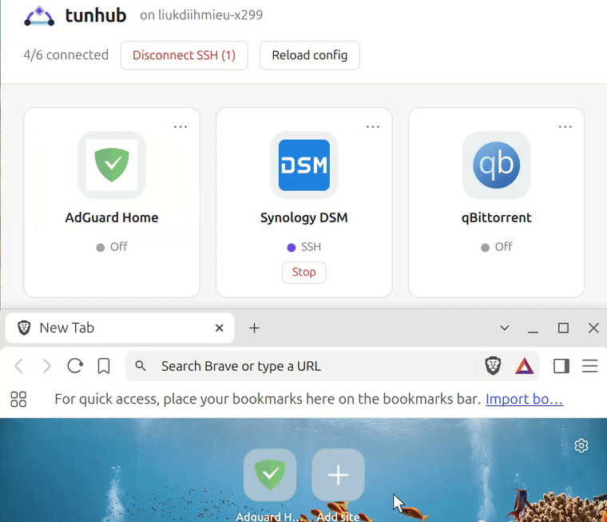
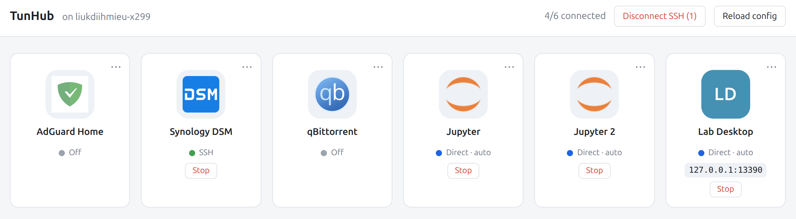
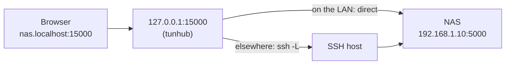
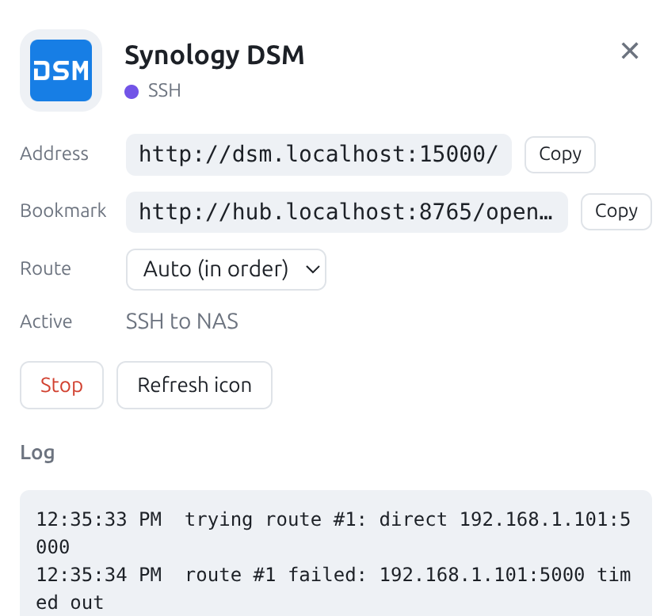

<h1>
  <picture>
    <source media="(prefers-color-scheme: dark)" srcset="docs/images/logo-dark.svg">
    
  </picture>
</h1>

**Open the web UIs on your private network like any public website. tunhub sets up the SSH forwarding for you.**

[](https://github.com/LiukDiihMieu/tunhub/actions/workflows/ci.yml)


[](LICENSE)

<p align="center">
  
  <br><sub>A plain browser favourite opens AdGuard; tunhub starts the SSH tunnel on the way.</sub>
</p>

You self-host services with a web UI: Jupyter on a lab workstation, the admin
page of your NAS, AdGuard, Grafana, ... For security, they stay off the public
internet. So every time you need one, you first start an `ssh -L` forward, then
recall which local port it was, then type the address. Again and again, on every
computer you use.

tunhub takes those steps away. It runs quietly on your own computer: click a
tile on its dashboard, or simply open a bookmark, and tunhub picks a route,
opens the SSH tunnel if one is needed, waits until the service answers, and
takes you there. When you are on the same LAN, it skips SSH and connects directly.

- **One click from the hub.** Click a tile and the service opens in a new tab,
  with the tunnel already up.
- **Bookmarks that just work.** Save `http://hub.localhost:8765/open/nas` in your
  favourites bar and use it like any public website. If the tunnel is down,
  tunhub opens it on the way; you never think about it.
- **Direct when it can, SSH when it must.** On the same LAN, tunhub connects
  directly (cyan dot). Everywhere else, it goes through SSH (purple dot).
- **Addresses that never change.** The NAS is always `http://nas.localhost:15000`,
  whatever the route, so saved passwords and cookies keep working.
- **Not just web pages.** RDP, VNC, databases and other TCP services get an
  on/off tile that copies their address for your client.
- **Lightweight.** One Python process using about 50 MB of memory and
  practically no CPU when idle, plus about 4 MB for each active ssh tunnel.

<p align="center">
  
</p>

## Get started

You need Python 3.10+ and an OpenSSH client (built into Linux, macOS and Windows 10+).

```bash
uv tool install git+https://github.com/LiukDiihMieu/tunhub   # or: pipx install ...
tunhub init                     # writes an example config
$EDITOR ~/.config/tunhub/services.yaml
tunhub                          # then open http://hub.localhost:8765
tunhub service install          # optional: start automatically at login
```

In Chromium-based browsers (Chrome, Edge, Brave) you can also install the
dashboard as an app from the address bar. It then opens in its own window with
its own dock or taskbar icon.

A service is a local port plus a list of routes, tried in order:

```yaml
services:
  nas:
    local_port: 15000
    routes:
      - direct: 192.168.1.10:5000   # tried first, when you are at home
      - ssh: nas                    # Host alias from ~/.ssh/config
        remote: 127.0.0.1:5000      # as seen from the SSH server
```

SSH routes run non-interactively, so they need key authentication (or a loaded
ssh-agent) and a host that is already in `known_hosts`. Run `ssh <alias>` once
by hand for each host before you add it.

## How it works



Whichever route wins, the service is served at the same local address:

| route  | what listens on 127.0.0.1:15000                  |
|--------|--------------------------------------------------|
| direct | a TCP relay inside tunhub (like `socat`)         |
| ssh    | `ssh -N -L 127.0.0.1:15000:127.0.0.1:5000 nas`   |

Each web service gets its own host name, `http://<id>.localhost:<local_port>`.
Browsers share cookies between ports, but not between host names, so this keeps
logins and password-manager entries apart. Chromium-based browsers and Firefox
resolve `*.localhost` to 127.0.0.1 without any DNS setup.

### Address or bookmark?

Every web service has two URLs, both shown in its ⋯ panel:

| | example | what it is for |
|---|---|---|
| **Bookmark** | `http://hub.localhost:8765/open/nas` | Save this one in your browser. Opening it connects the service first (starting ssh if needed), then forwards you to the address. |
| **Address** | `http://nas.localhost:15000` | Where the service itself lives. Your password manager and cookies are tied to it, and it never changes with the route. It only loads while the service is connected. |

So you bookmark the hub link, and your password manager remembers the login
under the address, without any extra setup.

### Connection behaviour

- **Manual connections** (tile click, bookmark, Start, `autostart: true`) try the
  routes in order and keep the service up. If ssh dies or a direct target
  disappears, tunhub tries all routes again from the first; while every route
  fails, retries back off from 2 s to 60 s.
- **Auto-direct** (on by default): every 15 s, tunhub probes the direct routes of
  idle services and brings a service up as soon as one is reachable. Auto
  connections only ever use direct routes and never start ssh. When the direct
  route is lost, an auto connection simply goes back to off.
- **Stop** on a tile pauses auto-direct for that service until you start it
  again. **Disconnect SSH** in the top bar stops every service that uses or is
  trying ssh, keeps direct connections up and does not pause auto-direct.
- After a network change, ssh notices its dead connection within about 45 s
  (keep-alive). To switch immediately, click Stop and then the tile.

The **⋯** button on a tile shows its address, bookmark URL, route choice and live log:

<p align="center">
  
</p>

## Configuration

`tunhub init` creates the config directory with a commented example:

| OS      | config directory                                |
|---------|-------------------------------------------------|
| Linux   | `$XDG_CONFIG_HOME/tunhub` or `~/.config/tunhub` |
| macOS   | `~/.config/tunhub`                              |
| Windows | `%APPDATA%\tunhub`                              |

To use another directory, set `TUNHUB_CONFIG_DIR` or pass `--config-dir`.

- **`services.yaml`** is the shared definition. Keep it in a dotfiles repo to
  sync it between your machines.
- **`local.yaml`** holds optional per-machine overrides and is merged on top of
  `services.yaml`: mappings key by key, lists such as `routes` as a whole. Use it when a
  machine *is* one of the servers (reach its services via `127.0.0.1`, hide its
  own remote desktop with `enabled: false`), or when a port is taken.
  See `local.example.yaml`.

Click **Reload config** in the dashboard after editing. Services whose definition did not
change keep their connections. Changes to the `hub:` section need a restart.

Every key is explained in the comments of the example files that `tunhub init`
writes: [`services.yaml`](tunhub/templates/services.yaml) and
[`local.example.yaml`](tunhub/templates/local.example.yaml).

## Start at login

```bash
tunhub service install     # also: uninstall, status
```

| OS      | mechanism                          | logs |
|---------|------------------------------------|------|
| Linux   | systemd user unit `tunhub.service` | `journalctl --user -u tunhub -f` |
| macOS   | LaunchAgent                        | `~/Library/Logs/tunhub.log` |
| Windows | Task Scheduler (`pythonw`, no console window) | `%LOCALAPPDATA%\tunhub\tunhub.log` |

The service runs the same Python interpreter that installed it. If you pass
`--config-dir` (or have `TUNHUB_CONFIG_DIR` set), it is written into the service.
On Linux, the systemd user session must see your ssh-agent (`SSH_AUTH_SOCK`);
GNOME's agent normally takes care of that.

On Windows, stop tunhub before upgrading it, because Windows cannot replace a
program that is running (`uv` then fails with "Access is denied"):

```powershell
Stop-ScheduledTask -TaskName TunHub
uv tool upgrade tunhub
Start-ScheduledTask -TaskName TunHub
```

## Security

- The dashboard and all forwards listen on 127.0.0.1 only.
- Requests whose `Host` is not the dashboard's own host name are rejected, which
  blocks DNS rebinding.
- State-changing API calls need a custom header and a same-origin `Origin`, so
  other web pages cannot trigger them.
- Other web pages cannot open a tunnel through `/open/<id>` either (for example
  with a hidden ``): tunhub only accepts bookmarks, typed URLs, the
  dashboard itself and links that you click.
- The dashboard refuses to be shown inside another site's frame (clickjacking).
- Only services defined in your config can be opened. The web UI never runs
  arbitrary commands.
- Service icons are fetched only through the service's own local port; tunhub
  never contacts other sites. They are served with a sandboxing CSP and shown
  only as ``.

### Direct routes on other networks: `known_macs`

Private addresses are reused everywhere. In a café whose network also uses
`192.168.1.x`, another device might answer on your NAS's address, and the
browser would send it your NAS cookies. tunhub avoids such accidental
misconnections the way ssh handles host keys with `known_hosts`:

- The first time a direct route connects, tunhub records the MAC address of
  the next hop toward the target (the target itself on the same subnet, else
  the router) in `known_macs`, next to `services.yaml`:
  `Permanently added 192.168.1.10 (aa:bb:cc:dd:ee:01) to known_macs`.
- Later, a direct route is used only if that MAC matches. Otherwise it is
  skipped (falling back to ssh, if configured) and the tile shows ⚠.
- When the network changes, or cannot be determined, running direct routes
  are checked again; a route that still reaches the same machine stays up.
- If a MAC changes for a good reason (new network card, another router),
  run `tunhub forget <ip>` or edit `known_macs`; several lines for one IP are
  all trusted. The file can be synced together with your config.

This prevents accidents, not deliberate attacks: someone on the same network
can fake a MAC. Targets reached through a VPN have no visible MAC and are used
without this check. Give direct targets a fixed address (a static IP or a DHCP
reservation): a running direct route is re-checked when the network changes,
not when an address is handed to another machine on the same network.

## How does it compare?

|                                   | opens on click | picks direct or SSH | nothing on servers | non-web services |
|-----------------------------------|:---:|:---:|:---:|:---:|
| **tunhub**                        | ✅ | ✅ | ✅ | ✅ |
| SSH tunnel managers (GUI / web)   | –  | –  | ✅ | ✅ |
| Homelab dashboards (Homer, Homepage, Dashy) | ✅ | – | ✅ | – |
| Mesh VPNs (Tailscale, ZeroTier, WireGuard) | – | ✅ | – | ✅ |

- **SSH tunnel managers** handle individual `-L` forwards. You still map ports
  to services in your head, and nothing connects when you open a bookmark.
- **Homelab dashboards** are link pages: they can't reach a service that needs a tunnel.
- **Mesh VPNs** are great when you can install an agent on every server. tunhub
  is for the places where you can't or don't want to: university or company
  machines reachable only over SSH, jump hosts, or a NAS you would rather not
  run a VPN on.

## Development

```bash
git clone https://github.com/LiukDiihMieu/tunhub && cd tunhub
uv sync --extra dev
uv run pytest
uv run tunhub --config-dir ./my-test-config
```

The tests use `tests/fake_ssh.py` in place of ssh to exercise the SSH routes,
including reconnecting after the ssh process is killed.

Icons, logos and the social preview image are generated by
`tools/make_icons.py`; see its docstring to regenerate them.

## License

[GPL-3.0-or-later](LICENSE). You may use, modify and redistribute tunhub, but any
distributed modified version or derivative work must also be released under the GPL.
